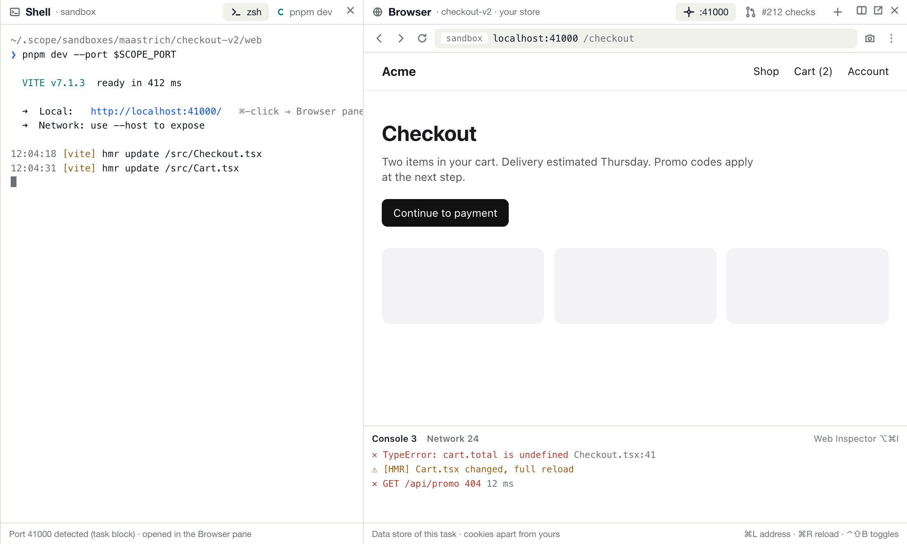
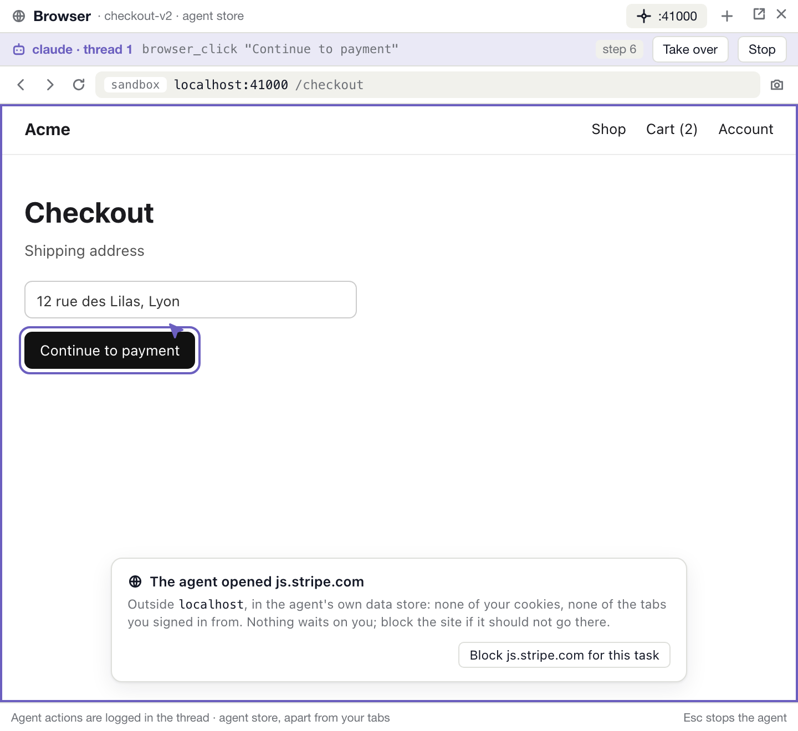
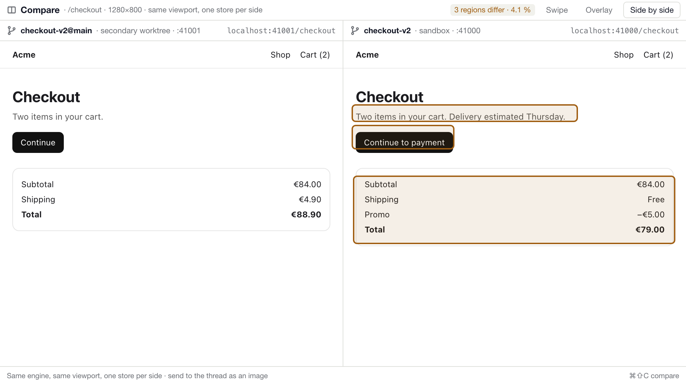

# Un navigateur intégré à Scope

Recherche, octobre 2026 (Scope 0.27.0, Claude Code 2.1.304, macOS 26.5). Aucun code de production : un
prototype jetable a servi à trancher les questions WebKit (§3.2). Il n'est pas commité, ses résultats sont ici.
Maquettes : `docs/research/browser/` (`python3 docs/research/browser/build.py`).

## Verdict

**Oui, mais un navigateur de task, pas un navigateur généraliste.** Il prend la forme d'un pane *Browser* dans la
colonne de lecture, construit sur **WKWebView**, au même titre que le Shell de #85.

1. **Pour l'utilisateur, d'abord.** Il sert à voir le serveur de dev de la task (les ports de son bloc), à côté
   du terminal, avec la console. Le reste du web (PR, CI, docs) continue d'aller au navigateur système par
   défaut, là où l'utilisateur est connecté. Une préférence permet de tout ouvrir dans le pane.
2. **Pour les agents, ensuite.** Scope sert une poignée d'outils MCP `scope_browser_*` sur le pont existant
   (`scope mcp` → socket → `ControlService`). L'agent travaille dans le *même* pane que celui que l'utilisateur
   regarde, avec un *store* de données propre à la task, sans extension ni connexion claude.ai. C'est ce que ni
   Claude in Chrome, ni Playwright MCP ne donnent à un thread Scope.
3. **On ne refait pas Playwright.** WKWebView n'expose publiquement ni d'entrée souris de confiance, ni de
   statut HTTP, ni de traces de performance (mesuré, §3.2). Quand un agent en a besoin, Scope ne réimplémente
   rien : il déclare pour la task un `chrome-devtools-mcp` ou un Playwright MCP sur un profil isolé sous
   `SCOPE_HOME`. C'est de la configuration, pas un second moteur.
4. **Ni CEF, ni Chromium embarqué.** Il pèserait environ 300 Mo et suivrait Chromium toutes les quatre
   semaines, pour un gain que la délégation du point 3 donne gratuitement.

Premier pas, taille S : le pane Browser côté utilisateur, sans aucun outil agent. Les chips de port et le ⌘-clic
sur une URL `localhost` du bloc de la task y mènent ; le routage est une fonction pure testée dans le package
(§7).

---

## 1. Ce qui existe déjà dans Scope

Scope n'a aucune vue web aujourd'hui : aucun `import WebKit` dans `App/`, `Sources/` ni `project.yml`. Tout lien
web part chez `NSWorkspace.shared.open`.

| Surface | Aujourd'hui | Où |
|---|---|---|
| **Ports** | Chaque task reçoit un bloc de 10 ports (41000–48999, 31000–38999 en Debug), dont le premier est `SCOPE_PORT`. Toutes les 20 s, tant qu'un thread vit, Scope liste les ports TCP en écoute des processus de la task. Seuls les ports **du bloc** deviennent des chips `localhost:41003 ↗`, et un clic ouvre le navigateur système. | SPEC.md:109-110, `AppModel+Ports.swift:12-43`, `Sources/ScopeCore/ListeningPorts.swift:61-80`, `TaskPortChips.swift`, `EnvironmentCard.swift:74-98` |
| **Liens du terminal** | Le ⌘-clic passe par `requestOpenLink` puis `openFileLink`. Un chemin s'ouvre dans le viewer `.path` ; une URL web tombe dans SwiftTerm, qui la donne au système. | `ScopeTerminalView.swift:42`, `AppModel+Inspector.swift:99-108`, SPEC.md:326 |
| **Liens Markdown** | `MarkdownLink.classify` ; un lien `.web` part dans `NSWorkspace`. | `AppModel+Reading.swift:143-147` |
| **Colonne de lecture** | `InspectorViewer` = `diff, file, path, reading, shell`. Le pane strip affiche Overview / Changes / Shell / Pull requests / Files. | `InspectorModel.swift:6`, `InspectorViewerColumn.swift:18`, `InspectorPaneStrip.swift` |
| **PR et CI** | Toutes les PR d'une task, avec leurs checks (échecs en tête), les reviews, *Send to Thread* sur un check rouge. Chaque `detailsURL` s'ouvre au navigateur. Aucun artifact CI n'est affiché. | `PullRequestSection.swift`, `TaskPullRequestPanel.swift:132`, `ArtifactsCard.swift:5-7` |
| **MCP** | Il y a 27 outils `scope_*` (`MCPBridge.swift`). `scope mcp` relaie chaque appel en `ControlCall` sur le socket 0600 ; le policy (`AutomationPolicy.decide`) puis `AppControlService.perform` s'appliquent. Les réponses sont **uniquement texte** et les messages du socket sont **plafonnés à 1 Mio**. | `Sources/scope/MCPServer.swift:52-57`, `UnixSocketServer.swift:52` |

Conséquences pour le design :

- **Rien à dupliquer.** Les chips de port, le ⌘-clic et les PR existent déjà ; il suffit de changer leur
  *destination*, sans rien ajouter à côté.
- **Le port par défaut de Vite (5173) n'est jamais détecté**, puisqu'il est hors du bloc de la task. La preview
  repose donc sur `--port $SCOPE_PORT`, ou sur une détection élargie (§7, M1).
- **Le patron du Shell (#85) se reproduit tel quel.** On ajoute un cas d'`InspectorViewer`, une règle
  `isShowable`, une branche dans `InspectorViewerColumn`, un `PaneButton`, et un store de sessions fermé à
  l'archivage comme `TaskShellStore.removeAll(of:)`.
- **Une capture d'écran ne passe pas telle quelle sur le socket.** Il faut une image réduite écrite dans un
  fichier, et un `MCPServer` capable d'émettre du contenu image.

## 2. Usages

| Usage | Pour qui | Valeur dans Scope | Verdict |
|---|---|---|---|
| **Preview du serveur de dev d'une task** | utilisateur | Forte. Le serveur tourne dans la sandbox, et voir le résultat à côté du terminal sans changer d'app est le cœur du besoin. Claude Desktop, Codex, Cursor, VS Code et Vibe Kanban l'ont tous. | **S** |
| **Agent qui vérifie son travail** (capture, lecture, clic, console) | agent | Forte. C'est la boucle « je code, je regarde, je corrige » que Claude Desktop met en avant (`autoVerify` actif par défaut). | **M** |
| **Avant/après entre deux branches** | les deux | Moyenne à forte pour du front. Ça repose sur les worktrees secondaires (`api@main`), donc pas sur le checkout de l'utilisateur, avec un port du bloc par côté. | **M3** |
| **Lecture de la PR, des checks, des artifacts** | utilisateur | Faible. La carte Pull requests montre déjà l'état ; les pages GitHub demandent une connexion que l'utilisateur a déjà dans son navigateur. Les artifacts publics (Pages, previews de déploiement) s'ouvrent bien dans le pane. | navigateur système par défaut ; pane en option |
| **Docs** | les deux | Faible. L'agent a WebFetch ; l'utilisateur a son navigateur, ses favoris et ses onglets. | navigateur système |

## 3. Moteur

### 3.1 Options

| Option | Couverture des usages | Effort | Risque | Maintenance | Taille ajoutée |
|---|---|---|---|---|---|
| **A. Statu quo** (tout au navigateur système) | Docs, PR. Ni preview intégrée, ni agent. | 0 | nul | nulle | 0 |
| **B. Pane WKWebView, utilisateur seul** | Preview, artifacts, console. | S | faible | faible : WebKit suit l'OS | 0 (framework système) |
| **C. B + outils MCP `scope_browser_*` servis par Scope** ✅ | B, plus la vérification par l'agent (capture, lecture, clic DOM, saisie, console) et l'avant/après. | M | moyen (injection, §5) | moyenne : du JS de capture à maintenir face à WebKit | 0 |
| **D. CEF / Chromium embarqué** | Tout, avec CDP natif. | L+ (pont C/ObjC++, app helper multi-processus) | moyen (CVE Chromium à suivre) | lourde : branche Chromium toutes les ~4 semaines | ~300 Mo (cef 149 : 354 Mo installé, l'app JetBrains cef_server : 297 Mo) |
| **E. Scope pilote un Chrome externe via CDP** | Tout côté agent, mais l'utilisateur regarde une autre fenêtre. | M | moyen : Chrome 136+ refuse `--remote-debugging-port` sur le profil par défaut, il faut un `--user-data-dir` dédié | moyenne | 0 (dépend de Chrome) |
| **F. Délégation : Scope déclare par task un `chrome-devtools-mcp` / Playwright MCP sur un profil isolé** | Agent complet (souris de confiance, réseau avec statuts, traces, Lighthouse), sans pane partagé. | S (configuration) | faible à moyen (« not a security boundary », dit Playwright) | faible : maintenu par Google ou Microsoft | 0 (npx) |

**Recommandation : C pour le pane et la boucle courante, F en complément pour les cas lourds.** D et E sont
écartées. D coûte le prix d'un navigateur entier. E sépare ce que voit l'agent de ce que voit l'utilisateur,
alors que c'est précisément ce que C apporte.

### 3.2 Ce que WKWebView fait vraiment (essais sur la machine)

Le prototype est une app Swift en ligne de commande, sans fenêtre visible, contre un `http.server` local et
un proxy Python de journalisation. Il tourne sur macOS 26.5.2 avec Swift 6.3.3.

| Question | Résultat | Conséquence |
|---|---|---|
| Capture **sans fenêtre** (`takeSnapshot`) | ✅ 1024×700 sans `NSWindow`, et pareil dans une fenêtre hors écran. Chargement à froid : 674 ms. | L'agent capture un onglet que le pane ne montre pas. |
| Isolation par `WKWebsiteDataStore(forIdentifier:)` | ✅ Les cookies de A et de B restent séparés. Les stores sont listés par `allDataStoreIdentifiers`. | Un store par task (agent) et un par scope (utilisateur) fonctionnent. |
| **Emplacement** des stores | ⚠️ `~/Library/WebKit/<bundle id>/WebsiteDataStore/<uuid>/` (Cookies, CacheStorage…), **hors de `SCOPE_HOME`**. `remove(forIdentifier:)` échoue tant qu'une vue utilise le store : les deux dossiers du premier essai étaient restés. | Il faut une ligne dans `DEBUG_ISOLATION.md`, des UUID dérivés du home et de la task, et la suppression *après* la fermeture des vues (§8). |
| Console | ✅ `console.*` et les erreurs non attrapées sont relayées par un script injecté *à document start*. Il pose un pont DOM dans le monde de la page et écoute depuis un `WKContentWorld` nommé. | `scope_browser_console` est faisable. Le relais vit dans le monde de la page, qui peut donc le neutraliser : c'est un outil de debug, pas une preuve. |
| Réseau | ⚠️ `PerformanceObserver` donne l'URL, le type et la durée, mais `responseStatus` reste **indéfini** : le 404 n'apparaissait que parce que la page le loguait. Il n'existe aucune API publique, et `setURLSchemeHandler` refuse `http`/`https`. | `scope_browser_network` = URLs + durées. Les statuts n'existent que pour `fetch`/XHR enveloppés côté page (falsifiable), et restent absents pour la navigation, les images et le CSS. Il faut le dire dans la description de l'outil. |
| Proxy par store (`proxyConfigurations`, macOS 14) | ⚠️ Les hôtes distants passent par le proxy (CONNECT, nom d'hôte seulement en HTTPS) et sont bloquables. **`localhost` et `127.0.0.1` le contournent.** | C'est un garde-fou d'hôtes hors localhost, pas un journal réseau. |
| Blocage par `WKContentRuleList` | ✅ Avec « tout bloquer + `ignore-previous-rules` pour 127.0.0.1 », `example.com` échoue avec *The URL was blocked by a content blocker*. | La liste de sites bloqués se fait sans proxy, nativement, et couvre aussi les sous-ressources. |
| Lecture de page depuis un monde isolé | ✅ La page avait remplacé `getAttribute` et `querySelectorAll`. Dans le monde de la page, la lecture rend `[]` ; dans le monde `scope`, l'arbre est complet. Le texte caché d'injection est marqué `(hidden)` par `checkVisibility()`. | `read_page` résiste au JS hostile mais pas au DOM hostile : un texte d'injection **visible** passe tel quel (§5). |
| Clic | ❌ `element.click()` en JS → `isTrusted=false`. Les `NSEvent` souris de synthèse (`hitTest().mouseDown`, `window.sendEvent` hors écran, puis fenêtre clé en `.accessory`) n'ont **rien déclenché** en trois variantes. | Les clics passent par le DOM (`isTrusted=false`). Ça casse ce qui exige une activation utilisateur : popups, `input type=file`, presse-papier, plein écran. C'est une limite documentée, et la raison d'être de l'option F. |
| Saisie clavier | ✅ Avec `window.sendEvent` de `keyDown`/`keyUp` sur un champ focalisé, la valeur devient `hey`. | `scope_browser_type` passe par de vrais événements clavier. |
| PDF (`pdf()`) | ✅ 19 Ko. | Un artifact de vérification possible. |
| Mémoire | Un processus WebContent par vue (~34 Mo RSS sur une page simple), plus un Networking (~23 Mo) et un GPU (~30 Mo) partagés. | Il faut fermer les vues des tasks inactives (§8). |
| Inspection | `isInspectable = true` → Web Inspector via Safari ▸ Développement. | Le bouton « Web Inspector » du pane, pour l'humain. Il n'est pas pilotable par un agent : le protocole d'inspection distante est privé. |

Autres faits documentés :

- **Playwright et safaridriver ne peuvent pas piloter une WKWebView embarquée.** Le WebKit de Playwright est
  son propre build. WebDriver ne pilote que Safari (WebKit WebDriverNotes 2018, Apple forums 748456).
- **`WebPage` et `WebView` SwiftUI** (WWDC25, macOS 26) offrent le même socle, enveloppé. Scope cible plus bas
  que macOS 26, donc on reste sur `WKWebView` dans un `NSViewRepresentable`, comme le terminal.

## 4. Pilotage par les agents

### 4.1 L'existant

| | Claude in Chrome | Navigateur de Claude Desktop | Playwright MCP | chrome-devtools-mcp | **Scope (option C)** |
|---|---|---|---|---|---|
| Moteur | le Chrome de l'utilisateur | intégré à l'app (moteur non documenté) | Chromium, Firefox ou WebKit de Playwright | Chrome / Chrome for Testing | WKWebView système |
| Session | **les connexions de l'utilisateur** | profil propre, *Keep cookies* en option | profil persistant par workspace, ou `--isolated` | profil dédié | store agent par task, distinct du store utilisateur |
| L'humain voit la même page | oui (un onglet de son Chrome) | oui (le pane) | non (fenêtre à part ou headless) | non | **oui (le pane de la task)** |
| Accès | `/login` claude.ai sur un plan direct ; extension ≥ 1.0.36 ; ni clé API, ni Bedrock ou Vertex | l'app desktop seulement, pas en SSH | `claude mcp add` | `claude mcp add` | `scope mcp`, déjà enregistré par Scope |
| Permissions | permissions par site de l'extension | Allow once / Always / Deny par site ; localhost sans approbation ; classifieurs sur les écritures externes | `--allowed-origins`, « not a security boundary » | aucune | §5 |
| Outils | navigate, read_page, find, computer, form_input, console, network, gif… | captures, DOM, clics, formulaires, `preview_start`, `.claude/launch.json` | snapshot a11y avec refs, click, type, console, network, screenshot… | 59 outils, dont traces de performance et Lighthouse | §4.3 |

À retenir :

- **Claude Desktop est le modèle produit à suivre** : un profil propre, localhost sans friction, une approbation
  par site, `launch.json`. Les threads Scope sont des CLI, ils n'y ont pas accès.
- **Claude in Chrome est le contraire de l'isolation.** Il agit avec les cookies de l'utilisateur et exige une
  connexion claude.ai. La doc précise qu'un projet ne peut pas l'activer (« a repository you check out must not
  be able to connect Claude to your browser »).
- **Playwright MCP est le meilleur pilote**, mais ce qu'il ouvre ne se voit pas dans Scope.
- **Concurrence.** Cursor a un navigateur agent depuis 2025-09 ; on y signale des captures périmées et des outils
  perdus entre versions. VS Code a un navigateur intégré avec outils agent, GA 2026-07, avec des sessions
  éphémères isolées pour les pages ouvertes par l'agent et un *partage* explicite d'un onglet utilisateur.
  Codex a un navigateur intégré depuis 2026-04. Vibe Kanban détecte l'URL du serveur dans les logs. Zed et Warp
  n'ont rien, avec des issues ouvertes. Conductor n'en a pas, d'après sa doc.

### 4.2 Le partage entre C et F

Scope sert lui-même ce qui exige **le pane partagé**, et délègue ce qui exige **un vrai moteur
d'automatisation** :

- **Scope (`scope_browser_*`)** : ouvrir une URL dans le pane de la task, capturer, lire la page, cliquer et
  saisir au niveau DOM, attendre un sélecteur, lire la console et la liste réseau (URLs et durées), comparer
  deux branches.
- **Délégation (F)** : saisie de confiance, statuts et corps HTTP, traces et Lighthouse, upload de fichiers,
  multi-navigateurs. Scope n'écrit rien dans le repo (CLAUDE.md). La task peut déjà porter un fichier de
  contexte (`CLAUDE.local.md`) ; une ligne y pointe vers un MCP lancé avec `--user-data-dir
  $SCOPE_HOME/browser/<task>`, ou Scope l'enregistre lui-même via `MCPRegistration`. Cette délégation reste
  facultative : elle n'est utile que si la boucle C se révèle insuffisante à l'usage.

### 4.3 Le canal : outils `scope_browser_*` sur le pont existant

Les outils empruntent le même chemin que les autres :
`MCPBridge` → `ControlCall` → socket → `ControlDispatch` (origine, policy, budget) → `AppControlService.perform`
→ `BrowserStore` (`@MainActor`).

La task est déduite de `SCOPE_TASK` du thread appelant. Un agent ne pilote que le navigateur de **sa** task,
selon la même logique que `mayTouch` pour les threads.

| Outil | Rôle | Retour |
|---|---|---|
| `scope_browser_open` | ouvre ou réutilise l'onglet agent de la task ; `url` ou `port` (index dans le bloc) | URL finale, titre, statut de chargement |
| `scope_browser_read` | texte et éléments interactifs avec des refs (`e12`), lus dans le monde isolé, texte caché marqué ; le tout encadré comme contenu non fiable (§5) | texte ≤ 50 000 caractères |
| `scope_browser_screenshot` | capture du viewport ou d'un élément | JPEG réduit (≤ 1280 px) écrit sous `SCOPE_HOME/browser/shots/`, renvoyé en `ImageContent` par `scope mcp` |
| `scope_browser_click` / `scope_browser_type` | clic DOM sur une ref ; saisie par événements clavier | nouvel état court de la page |
| `scope_browser_wait` | sélecteur, texte ou réseau calme, avec délai | ok / timeout |
| `scope_browser_console` / `scope_browser_network` | journaux depuis le dernier appel | lignes ; statuts présents seulement pour fetch/XHR, et dit tel quel |
| `scope_browser_compare` (M3) | captures de la même route sur deux ports | deux images et un pourcentage de pixels différents |

Contraintes de mise en œuvre :

- **`MCPServer.swift` n'émet que `.text`.** Il faut ajouter le cas image, sans `structuredContent` en double :
  le base64 dupliqué est un bug connu de Claude Code.
- **Le socket coupe à 1 Mio.** L'image transite donc par un *chemin de fichier* sous `SCOPE_HOME`, et c'est
  `scope mcp` qui la lit, côté agent.
- **Le plafond MCP de Claude Code s'applique aux images** (25 000 tokens par défaut, `MAX_MCP_OUTPUT_TOKENS`).
  On reste en JPEG réduit.
- **Pas d'outil `eval` arbitraire au départ.** L'agent a le code source, et `javascript_tool` est l'outil le
  plus dangereux face à l'injection.

## 5. Sécurité et permissions

Le principe directeur est la *triade létale* (Willison) : données privées + contenu non fiable + canal de sortie.
On retire la première jambe par **construction**, pas par des prompts. C'est cohérent avec la ligne « autonomie
d'abord » de Scope, qui veut des garde-fous structurels et une annulation facile, pas des approbations.

1. **Deux familles de stores, jamais partagées.**
   - **Store utilisateur** : un par scope, persistant. C'est là que l'utilisateur se connecte s'il le veut, par
     exemple à GitHub pour un artifact privé.
   - **Store agent** : un par task, persistant jusqu'à l'archivage, puis supprimé. Aucun cookie de
     l'utilisateur, aucun de ses onglets.
   - Les outils agent n'atteignent un onglet utilisateur que si l'utilisateur le **confie** explicitement
     (« Hand to agent », le modèle de VS Code). L'onglet est alors cloné dans le store agent.
2. **Pas de prompt d'approbation par défaut.** L'argument : avec un store vide, l'agent qui lit une page
   externe n'a rien de plus que son `WebFetch` ou son `curl`. Le navigateur n'ouvre aucun canal d'exfiltration
   nouveau. Ce que l'agent voit d'inhabituel est **montré**, pas demandé : un bandeau « l'agent a ouvert
   js.stripe.com », avec *Bloquer pour cette task* (maquette `agent-driving`).
3. **Réglages** (`AutomationSettings`), selon la règle « dans le doute, configurable » :
   - `browserSites` : `taskPorts` | `localhost` | `any` (défaut `any`) ;
   - une liste de blocage par task ou par scope, appliquée par `WKContentRuleList` ; elle couvre la navigation
     *et* les sous-ressources, ce qui a été mesuré ;
   - une approbation `browser` (`allow` par défaut), dans le même modèle allow/ask/deny que `threads` et
     `tasks`.
4. **Le contenu web est encadré comme non fiable.** `scope_browser_read` enveloppe le texte
   (`<untrusted-page origin=…>`), marque le texte caché, et le rappelle dans la description de l'outil.
   Le monde isolé protège contre le JS de la page, **pas** contre son DOM : un « ignore previous instructions »
   visible passe. La défense de fond reste le modèle : Anthropic mesure 1 % de succès d'attaque adaptative
   sur Claude for Chrome et le qualifie de « meaningful risk ».
5. **Téléchargements et fichiers.** `WKDownloadDelegate` ; tout va sous `SCOPE_HOME/browser/downloads/<task>/`,
   jamais dans les dossiers de l'utilisateur. Pas d'upload au départ : c'est de toute façon impossible sans
   saisie de confiance.
6. **Arrêt.** Esc ou *Stop* dans le bandeau coupe les appels en cours de l'agent sur ce navigateur. Chaque
   action agent est journalisée dans la colonne de lecture du thread, comme ses autres outils.
7. **Connexions dans le pane : non vérifié.** Google OAuth refuse les WebViews embarquées. Les passkeys dans
   une app signée ad hoc sont incertaines. D'où le défaut « web externe → navigateur système ».

## 6. Intégration UI

| Maquette | Contenu |
|---|---|
|  | **Pane Browser** à côté du Shell. Bande : onglets de la task (`:41000`, `#212 checks`, `+`), split, pop-out. Barre d'adresse avec l'origine (`sandbox`). Console et réseau repliables en pied. Store affiché. |
|  | **Un agent pilote.** Bandeau violet (couleur `origin-agent` existante) avec le thread, l'outil en cours, *Take over* et *Stop* ; anneau sur la cible ; signalement non bloquant d'un site hors localhost. |
|  | **Avant/après.** Worktree secondaire `@main` sur `:41001` contre la sandbox sur `:41000`, même viewport, régions différentes encadrées. |

(Variantes sombres : `browser/png/*-dark.png`.)

- **Où il vit.** Un viewer de la colonne de lecture (`InspectorViewer.browser`), un bouton globe dans le pane
  strip, raccourci ⌃⇧B. C'est le choix de Claude Desktop (icône Browser dans sa barre, cf.
  `claude-desktop-ui/README.md:42`). Ce n'est **pas** une carte : une page web demande de la hauteur. Le
  pop-out en fenêtre détachée vient avec celui du Shell (« plus tard » dans la recherche Claude Desktop).
- **Comment il s'ouvre** (routage, fonction pure dans `ScopeCore`) :
  - chip de port ou ⌘-clic sur `localhost`/`127.0.0.1` d'un port du bloc → pane de la task ;
  - autre `localhost` → pane (préférence) ;
  - web externe → navigateur système (préférence : *pane*) ;
  - ⌥-clic → l'autre destination.
- **Un jeu d'onglets par task.** Les URLs ouvertes sont gardées dans l'état UI (`~/Library/Application
  Support/Scope`) et rouvertes paresseusement. Les vues des tasks non affichées depuis N minutes sont
  détruites, puisqu'une vue coûte un processus.
- **Refonte UI en cours** (`ui-refresh-claude-desktop`). Le pane suit la même grammaire que Shell et Changes :
  une bande de 30 px, des onglets et un pied. Il n'introduit aucun composant nouveau en dehors de la barre
  d'adresse.

## 7. Architecture recommandée

```
            Claude Code (thread d'une task)                                 Utilisateur
                     │ MCP stdio                                                │ clic chip / ⌘-clic / ⌃⇧B
                     ▼                                                          ▼
   ┌───────────── scope mcp ─────────────┐                    ┌──────────── Scope.app (@MainActor) ────────────┐
   │ MCPBridge: scope_browser_*          │   ControlCall      │ ControlDispatch: origine → policy (browser,   │
   │ image ← fichier SCOPE_HOME/…/shots  │ ── socket 0600 ──▶ │ browserSites, fence « sa task ») → perform    │
   └─────────────────────────────────────┘   (≤ 1 Mio)        │        │                                       │
                                                              │        ▼                                       │
                                                              │ BrowserStore (par task)                        │
                                                              │  ├ onglets utilisateur → store scope (persist.)│
                                                              │  ├ onglets agent      → store task (→ archive) │
                                                              │  ├ WKContentRuleList (blocage)                 │
                                                              │  ├ monde « scope » : read / click / console    │
                                                              │  └ WKDownloadDelegate → SCOPE_HOME/downloads   │
                                                              │        │                                       │
                                                              │        ▼                                       │
                                                              │ InspectorViewer.browser → pane (colonne)       │
                                                              └────────┬───────────────────────────────────────┘
                                                                       │ http://localhost:<bloc de la task>
                                                                       ▼
                                                              serveur de dev dans la sandbox
   Optionnel (F) : chrome-devtools-mcp / Playwright MCP, --user-data-dir $SCOPE_HOME/browser/<task>, déclaré par Scope
```

Répartition du code, selon les règles du repo :

- **Package (testé)** :
  - `ScopeCore/BrowserRoute` : classification d'une URL selon le bloc de ports et les préférences ;
  - `BrowserStoreID` : UUID v5 dérivé de home + task ;
  - le blocage par site, compilé en JSON de règles ;
  - le cadrage « untrusted » des lectures ;
  - dans `ScopeControl` : `ControlMethod`/`ControlCall` des outils, policy et `MCPBridge`.
- **App** : `BrowserStore` et ses sessions (calqués sur `TaskShellStore`/`TaskShellSession`), `BrowserPane`,
  les scripts injectés (ressource JS), le branchement dans `AppControlService.perform`.

## 8. Plan par étapes

| Étape | Taille | Contenu | Fini quand |
|---|---|---|---|
| **S — Pane utilisateur** | S | `InspectorViewer.browser`, `BrowserStore` / `BrowserSession` (un onglet par port ouvert, store utilisateur par scope), pane avec barre d'adresse, back/forward/reload, `isInspectable`, ⌃⇧B, bouton du strip. Les chips de port et le ⌘-clic sur un port du bloc y mènent ; le reste ne change pas. `BrowserRoute` testé dans le package, préférence *Open web links*. SPEC §7, docs, `DEBUG_ISOLATION.md`. **Aucun outil agent.** | ⌘-clic sur `http://localhost:$SCOPE_PORT` ouvre le pane, la console du Web Inspector marche, l'archivage ferme les vues. |
| M1 — L'agent regarde | M | Store agent par task ; `scope_browser_open` / `read` / `screenshot` / `console` ; cas image dans `MCPServer` ; fichiers de capture sous `SCOPE_HOME` ; bandeau « agent ». Détection élargie : ports écoutés par les processus de la task hors bloc, et `url`/`port` de `.claude/launch.json` s'il existe. | Un thread capture et lit sa preview sans que l'utilisateur ait ouvert le pane. |
| M2 — L'agent agit | M | `click` / `type` / `wait` / `network`, réglages `browserSites` + blocage par `WKContentRuleList`, approbation `browser`, téléchargements, Stop/Esc, journal dans la colonne de lecture. Reprendre la saisie souris de confiance dans l'app réelle (fenêtre clé) ; sinon la limite est documentée. | Un agent remplit et soumet un formulaire de la preview, voit l'erreur de console, corrige. |
| M3 — Avant/après | M | `scope_browser_compare` et vue Compare sur worktree secondaire de base et sandbox, un port du bloc chacun. | Compare main/branche en un clic. |
| L — Délégation (optionnelle) | S–M | Scope déclare par task un `chrome-devtools-mcp` sur `--user-data-dir $SCOPE_HOME/browser/<task>` pointé sur les ports du bloc. | Seulement si M2 montre des manques réels (upload, traces). |

## 9. Risques

| Risque | Gravité | Parade |
|---|---|---|
| **Injection de prompt** par une page lue par l'agent | haute | store agent vide, pas d'`eval`, contenu encadré comme non fiable, texte caché marqué, blocage par site, Stop ; risque résiduel assumé (1 % mesuré par Anthropic) |
| **Clic sans activation utilisateur** (`isTrusted=false`) : popups, uploads et presse-papier échouent | moyenne | le dire dans la description de l'outil ; nouvel essai `NSEvent` en M2 ; délégation F |
| **Réseau partiel** : pas de statut hors fetch/XHR | moyenne | le dire ; `PerformanceObserver` + enveloppes ; F pour le détail |
| **Stores hors `SCOPE_HOME`** (`~/Library/WebKit/<bundle id>`) : deux builds Debug à homes différents partagent le dossier, et une suppression qui échoue en silence laisse des déchets | moyenne | UUID v5 (home + task), inventaire dans `SCOPE_HOME/browser/stores.json` et GC dans `scope gc`, suppression après fermeture des vues, ligne `DEBUG_ISOLATION.md` |
| **Mémoire** : un processus WebContent par vue | moyenne | vues paresseuses, destruction des tasks inactives, au plus N vues vivantes |
| **Ports hors bloc** (5173, 3000) invisibles | moyenne | `--port $SCOPE_PORT` documenté ; détection élargie et `launch.json` en M1 |
| **Doublon perçu avec Claude in Chrome ou Claude Desktop** | faible | positionnement : même pane que l'humain, store de task, sans connexion claude.ai ; rien qui touche au Chrome de l'utilisateur |
| **Connexions (OAuth Google, passkeys) cassées dans WKWebView** | faible | web externe → navigateur système par défaut |
| **Dérive WebKit** (comportements qui changent avec macOS) | faible | les scripts injectés n'utilisent que des API web standard ; le prototype sert de test de fumée |

## Sources

**Apple et WebKit**

- `WKWebsiteDataStore(forIdentifier:)` : https://webkit.org/blog/14423/building-profiles-with-new-webkit-api/
- `remove(forIdentifier:)` : https://developer.apple.com/documentation/webkit/wkwebsitedatastore/remove(foridentifier:completionhandler:)
- `isInspectable` : https://webkit.org/blog/13936/enabling-the-inspection-of-web-content-in-apps/
- `WKContentWorld` : https://developer.apple.com/documentation/webkit/wkcontentworld
- `setURLSchemeHandler` : https://developer.apple.com/documentation/webkit/wkwebviewconfiguration/seturlschemehandler(_:forurlscheme:)
- `WKDownloadDelegate` : https://developer.apple.com/documentation/webkit/wkdownloaddelegate
- `WebPage` : https://developer.apple.com/documentation/webkit/webpage et WWDC25 231
- WebDriver : https://trac.webkit.org/wiki/WebDriverNotes2018, https://developer.apple.com/forums/thread/748456
- Playwright WebKit : https://github.com/microsoft/playwright/issues/5795

**Chrome et CEF**

- https://developer.chrome.com/blog/remote-debugging-port
- https://github.com/ChromeDevTools/chrome-devtools-mcp
- https://archlinux.org/packages/extra/x86_64/cef/
- https://desktopinsights.com/apps/cef-server

**Claude**

- https://code.claude.com/docs/en/chrome
- https://code.claude.com/docs/en/desktop
- https://code.claude.com/docs/en/mcp
- https://claude.com/blog/claude-for-chrome
- https://www.anthropic.com/research/prompt-injection-defenses

**Autres outils**

- https://github.com/microsoft/playwright-mcp
- https://cursor.com/help/ai-features/browser
- https://code.visualstudio.com/docs/debugtest/integrated-browser
- https://docs.windsurf.com/windsurf/previews
- https://openai.com/index/codex-for-almost-everything/
- https://www.conductor.build/docs/workflow
- https://vibekanban.com/docs/browser-testing
- https://github.com/zed-industries/zed/discussions/27163
- https://github.com/warpdotdev/warp/issues/8548

**Injection**

- https://brave.com/blog/comet-prompt-injection/
- https://genai.owasp.org/llmrisk/llm01-prompt-injection/
- https://simonwillison.net/2025/Jun/16/the-lethal-trifecta/
